# Quan hệ bảng của ba quy trình MRML

Ba quy trình dùng chung phiếu cha `QT_MORONG_ML` và lần giao `GIAOPHIEU_MRML`. Phần bên dưới phiếu thì mỗi quy trình một cây.

`PHIEU_ID` là id lần giao (`GIAOPHIEU_MRML.ID_PHIEU`). `ID_PHIEU_MRML` là id phiếu cha (`QT_MORONG_ML.ID_PHIEU_MRML`).

```mermaid
flowchart TB
  subgraph vt["QT_MRML_02 — vô tuyến"]
    ML1["QT_MORONG_ML"]
    GP1["GIAOPHIEU_MRML"]
    TP["QT_MRML_TRAM_PHIEU"]
    TR["QT_MRML_TRAM"]
    PA1["QT_MRML_PADX<br/>PHIEU_ID = lần giao<br/>TRAM_ID có giá trị"]
    VT1["QT_MRML_VATTU<br/>PADX_ID<br/>THIETBI_ID trống"]
    ML1 -->|ID_PHIEU_MRML| GP1
    GP1 -->|ID_PHIEU| TP
    TP -->|TRAM_ID| TR
    GP1 -->|PHIEU_ID| PA1
    TR -->|TRAM_ID| PA1
    PA1 -->|PADX_ID| VT1
  end

  subgraph ac["QT_MRML_ACCESS"]
    ML2["QT_MORONG_ML"]
    GP2["GIAOPHIEU_MRML"]
    PP["QT_MRML_PHUONGAN_PHIEU"]
    P["QT_MRML_PHUONGAN"]
    TB2["QT_MRML_THIETBI<br/>ID_PHIEU_MRML<br/>THIETBI_ID = deviceId<br/>PADX_ID trống"]
    ML2 -->|ID_PHIEU_MRML| GP2
    ML2 -->|ID_PHIEU_MRML| PP
    PP -->|PA_ID| P
    ML2 -->|ID_PHIEU_MRML| TB2
  end

  subgraph mn["QT_MRML_MANE_32T"]
    ML3["QT_MORONG_ML<br/>PHUONG_AN là chữ"]
    GP3["GIAOPHIEU_MRML"]
    PA3["QT_MRML_PADX<br/>ID_PHIEU_MRML<br/>PHIEU_ID trống<br/>TRAM_ID trống"]
    TB3["QT_MRML_THIETBI<br/>PADX_ID + ID_PHIEU_MRML<br/>THIETBI_ID từ sequence<br/>A nhỏ hơn B"]
    VT3["QT_MRML_VATTU<br/>THIETBI_ID + PADX_ID"]
    ML3 -->|ID_PHIEU_MRML| GP3
    ML3 -->|ID_PHIEU_MRML| PA3
    PA3 -->|PADX_ID| TB3
    TB3 -->|THIETBI_ID| VT3
    PA3 -->|PADX_ID| VT3
  end
```

Vô tuyến đi qua trạm và gắn phương án vào một lần giao. Access gắn thiết bị thẳng vào phiếu cha, `THIETBI_ID` lấy từ `deviceId`. Mane gắn phương án vào phiếu cha, thiết bị A/B nằm dưới phương án, vật tư nằm dưới thiết bị.
